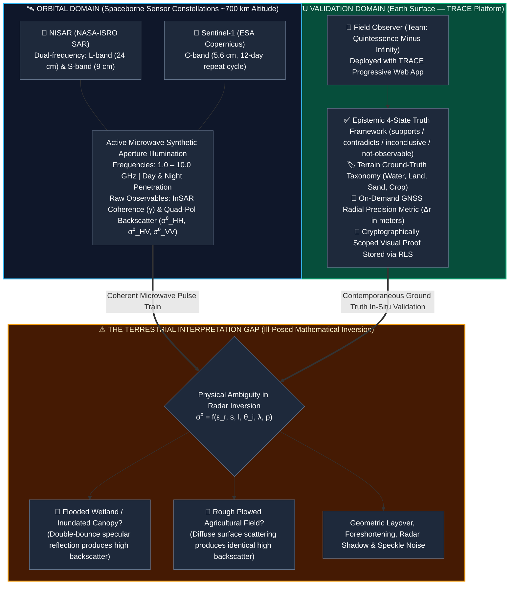
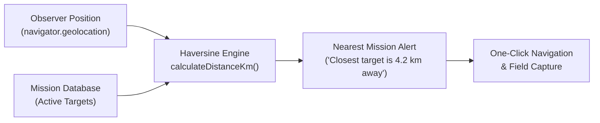
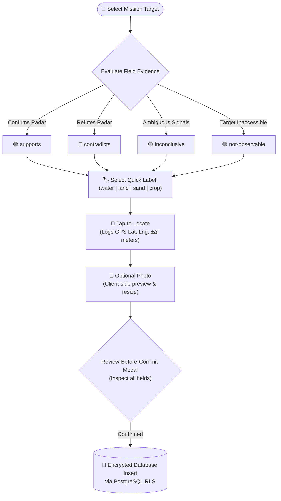
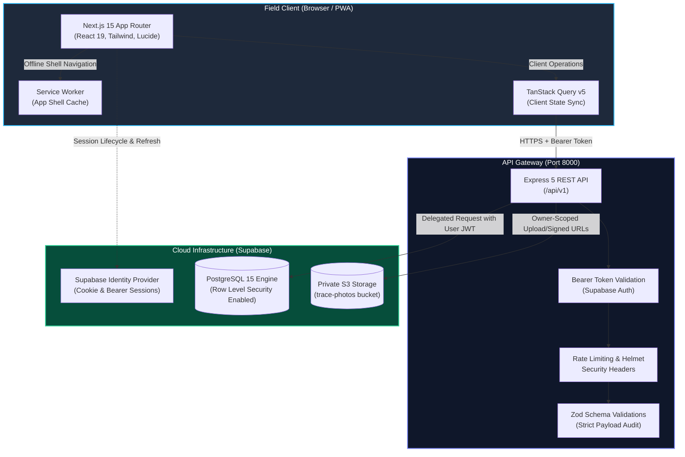
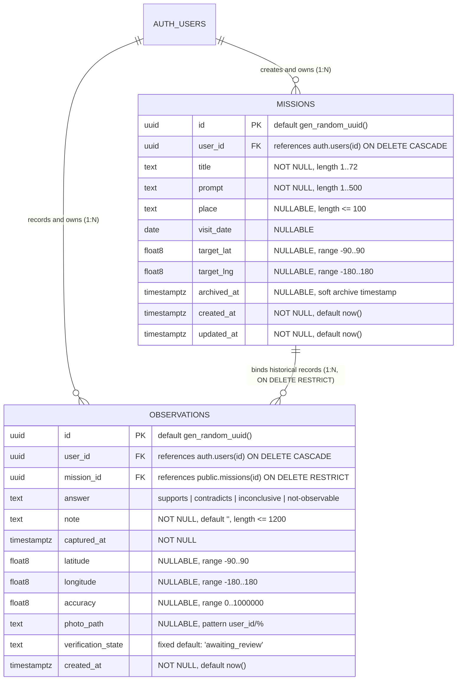

<div align="center">

# 🛰️ TRACE — Tactical Radar-ground-truth Acquisition & Calibration Environment
### A Zero-Trust In-Situ Ground-Truthing & Epistemic Verification Platform for Spaceborne Synthetic Aperture Radar

**NASA International Space Apps Challenge 2026**  
**Challenge Track:** [Dancing with the SARs](https://www.spaceappschallenge.org/2026/challenges/dancing-with-the-sars/?tab=details)

[](https://www.spaceappschallenge.org/2026/challenges/dancing-with-the-sars/?tab=details)
[](https://www.spaceappschallenge.org/2026/challenges/dancing-with-the-sars/?tab=details)
[](https://nana-space-apps-2026-trace.onrender.com/)
[](#20-scientific-boundaries-licensing--team-credits)

<br/>

[](https://nextjs.org/)
[](https://expressjs.com/)
[](https://supabase.com/)
[](https://www.typescriptlang.org/)
[](#4-application-shell-dashboard--tactical-navigation)
[](LICENSE)

<br/>

</div>

> [!IMPORTANT]
> ### 🌟 Official Project Identification & Live Production Deployment
> 
> | Operational Parameter | Specification & Gateway Link |
> | :--- | :--- |
> | 🏆 **Team Identification** | **`Quintessence Minus Infinity`** |
> | 🚀 **Live Production Application** | **[Launch TRACE Field Application ↗](https://nana-space-apps-2026-trace.onrender.com/)** (`https://nana-space-apps-2026-trace.onrender.com/`) |
> | 🛰️ **NASA Challenge Track** | **[Dancing with the SARs](https://www.spaceappschallenge.org/2026/challenges/dancing-with-the-sars/?tab=details)** — Synthetic Aperture Radar Earth Observation |
> | 📦 **Primary Artifact** | **TRACE** *(Tactical Radar-ground-truth Acquisition & Calibration Environment)* |
> | 📑 **Monograph Standard** | Unified Comprehensive Scientific Monograph *(Theory, Architecture, Full API & DDL)* |
> | 🛡️ **Security Model** | Zero-Trust Database Engine RLS (No Service-Role Key Bypass) + Scoped Storage Policies |
> | 🔖 **Production Version** | `v1.0.0-rc.1` (Enterprise & Field-Grade Ready) |

---

## Table of Contents

1. [Project Overview & Investigation Problem](#1-project-overview--investigation-problem)
2. [Study Areas & Radar Target Inventory](#2-study-areas--radar-target-inventory)
3. [Quick Start & Execution Guide](#3-quick-start--execution-guide)
4. [Application Shell, Dashboard & Tactical Navigation](#4-application-shell-dashboard--tactical-navigation)
5. [Bangladesh Radar Map Workspace](#5-bangladesh-radar-map-workspace)
6. [Satellite Radar Modal & Live NASA Telemetry](#6-satellite-radar-modal--live-nasa-telemetry)
7. [Guided In-Situ Observation Capture](#7-guided-in-situ-observation-capture)
8. [Records Ledger, Audit Trail & Verification State](#8-records-ledger-audit-trail--verification-state)
9. ["Feel the Radar" Sonification & Haptic Feedback](#9-feel-the-radar-sonification--haptic-feedback)
10. [Bilingual SAR Field Guide & Voice Synthesis](#10-bilingual-sar-field-guide--voice-synthesis)
11. [Data Sovereignty, Backup & Transactional Restore](#11-data-sovereignty-backup--transactional-restore)
12. [Scientific Method & Radar Physics](#12-scientific-method--radar-physics)
13. [Data Sources, Provenance & Checksums](#13-data-sources-provenance--checksums)
14. [System Architecture & Zero-Trust Engineering](#14-system-architecture--zero-trust-engineering)
15. [Complete REST API v1 Reference](#15-complete-rest-api-v1-reference)
16. [Database Schema, DDL & Security Policies](#16-database-schema-ddl--security-policies)
17. [Requirements Traceability Matrix (RTM)](#17-requirements-traceability-matrix-rtm)
18. [Testing, Verification & Quality Assurance](#18-testing-verification--quality-assurance)
19. [Troubleshooting Matrix & Operational FAQ](#19-troubleshooting-matrix--operational-faq)
20. [Scientific Boundaries, Licensing & Team Credits](#20-scientific-boundaries-licensing--team-credits)

---

## 1. Project Overview & Investigation Problem

### 1.1 The Investigation Problem: The "Ground-Truth Gap"
Synthetic Aperture Radar (SAR) satellites—such as **NISAR (NASA-ISRO SAR)**, **Sentinel-1 (ESA)**, and **ALOS-PALSAR (JAXA)**—provide all-weather, day-and-night observation of Earth's geophysical dynamics. By transmitting active coherent microwave pulses ($1 \text{ GHz} \le f \le 10 \text{ GHz}$), SAR penetrates clouds, monsoon rains, and darkness to measure surface changes.

However, satellite radar returns harbor a fundamental physical ambiguity: **The Ground-Truth Gap**.
Radar backscatter intensity ($\sigma^0$) is simultaneously modulated by both the surface's complex dielectric permittivity ($\epsilon_r$, governed by water content) and structural roughness ($s$):

$$\sigma^0 = f(\epsilon_r, s, l, \theta_i, \lambda, p)$$

Because an increase in soil moisture and an increase in surface roughness both produce elevated radar backscatter ($\sigma^0 \uparrow$), remote sensing scientists staring at an orbital radar image cannot definitively determine from space alone whether a sudden bright return represents:
1. **Flooded wetland / vegetation canopy** (causing high double-bounce specular scattering), or
2. **Rough, dry plowed agricultural land** (causing high diffuse surface scattering).

Without contemporaneous ground truth, scientific interpretations remain unconfirmed hypotheses.



### 1.2 What TRACE Does
**TRACE** (*Tactical Radar-ground-truth Acquisition & Calibration Environment*) is an offline-capable Progressive Web Application (PWA) and zero-trust verification runtime engineered for citizen scientists, agricultural extension workers, and disaster response teams. It enables observers to:
- Discover radar observation missions anchored to specific geographic coordinates.
- Inspect live satellite telemetry directly from the **Alaska Satellite Facility (ASF DAAC)** and **NASA CMR**.
- Record human in-situ truth using a scientifically disciplined **4-valued truth logic**.
- Classify surface terrain with rapid SAR validation tags (`water`, `land`, `sand`, `crop`).
- Capture on-demand GPS coordinates stamped with the hardware-reported horizontal accuracy radius ($\Delta r$).
- Experience radar backscatter via acoustic sonification and haptic vibration ("Feel the Radar").
- Listen to bilingual (Bengali & English) audio field guides.
- Maintain absolute data sovereignty via PostgreSQL Row-Level Security (RLS) and portable JSON backups.

### 1.3 Three Distinct Kinds of Output in TRACE

| Output Category | Scientific & System Meaning | Real TRACE Implementation Example |
| :--- | :--- | :--- |
| **In-Situ Ground Observation** | An empirical physical condition logged by a human observer at a timestamped location. | A field record marked `supports` with `quickLabel: "water"`, $\Delta r = 4.2\text{ m}$, and a ground photograph. |
| **Satellite Context & Telemetry** | Unmodified metadata and imagery queried live from NASA/ESA archives. | A Sentinel-1 SAR scene record from ASF DAAC, a GPM IMERG precipitation granule from NASA CMR, or a GIBS WMS tile. |
| **Pedagogical Simulation** | An interactive educational model to build radar intuition; explicitly not real-time telemetry. | The Web Audio API synthesizer mapping $-24\text{ dB} \to 150\text{ Hz}$ in `FeelRadarPlayer`, or the 12-day orbital pass clock. |

---

## 2. Study Areas & Radar Target Inventory

### 2.1 Geographic Coverage & National Scope
TRACE is natively calibrated for the dynamic deltaic landscape of **Bangladesh**—one of the world's most radar-critical flood and river erosion environments—while retaining global support for any WGS 84 coordinate pair $(-90 \le \phi \le 90, -180 \le \lambda \le 180)$.

The application bundles the official high-resolution boundary polygon (`/data/bangladesh-boundary.json`), spanning:
- **Latitude Span:** $20.55^\circ \text{N}$ to $26.65^\circ \text{N}$
- **Longitude Span:** $88.00^\circ \text{E}$ to $92.70^\circ \text{E}$
- **Geographic Center:** $23.85^\circ \text{N}, 90.35^\circ \text{E}$ (Default map viewport at zoom level 7)

```
                            26.65°N ──────────────────────────┐
                                    │      RANGPUR / JAMUNA    │
                                    │    (River Char & Silt)   │
                                    │                          │
                                    │    SYLHET HAOR BASIN     │
                                    │    (Wetlands & Floods)   │
                                    │    [24.8949°N, 91.8687°E]│
                                    │                          │
                                    │    DHAKA EMBANKMENTS     │
                                    │    (Padma / Concrete)    │
                                    │                          │
                                    │    SUNDARBANS MANGROVE   │
                                    │    (Tidal Mudflats)      │
                            20.55°N └──────────────────────────┘
                                    88.00°E                  92.70°E
```

### 2.2 Domain Categorization & Target Taxonomy
In `components/missions/bangladesh-radar-map.tsx`, TRACE automatically inspects mission titles, place descriptors, and prompts to classify targets into five ecological radar domains:

| Domain Name | Color Code | Badge Accent | Scattering Mechanics Validated | Target Landscape Examples |
| :--- | :---: | :---: | :--- | :--- |
| **Wetlands & Haor** | `#00b4d8` | Cyan Glow | Specular reflection, low backscatter ($-24\text{ dB}$), standing floodwater | Tanguar Haor, Hakaluki Haor, Sunamganj flood basins (`lat: 24.8949, lng: 91.8687`) |
| **River Char & Silt** | `#f59e0b` | Amber Glow | Surface roughness, sandbar accretion/erosion, silt deposition | Jamuna braided river channels, Chilmari–Roumari sandbars |
| **Tidal Mangrove** | `#10b981` | Emerald Glow | Canopy volume scattering (VH) vs. tidal mudflat specular reflection | Sundarbans delta, Passur River estuary, tidal creeks |
| **River Embankment** | `#818cf8` | Indigo Glow | Corner reflection from concrete blocks, revetment structures, dykes | Padma River training works, Jamuna bridge embankments |
| **General Ground Study**| `#d6f05d` | Lime Glow | Urban structures, mixed agricultural vegetation, general terrain | Agricultural fields, settlement perimeters |

---

## 3. Quick Start & Execution Guide

### 3.1 Prerequisites
- **Node.js:** `v20.9.0` or later (tested on Node 20.x, 22.x, and 24.x)
- **npm:** `v10.0.0` or later
- **Supabase Account:** Free tier project with Email/Password Auth enabled
- **Modern Browser:** Chrome, Edge, Firefox, or Safari with WebGL and Geolocation support

### 3.2 Local Setup (Windows / PowerShell)

```powershell
# 1. Clone repository from GitHub
git clone https://github.com/Tony1254-CS/nasa-26-app-240.git
cd "nasa-26-app-240"

# 2. Install workspace dependencies
npm ci

# 3. Configure environment variables
Copy-Item .env.example .env.local
```

Edit `.env.local` with your Supabase credentials:
```env
NEXT_PUBLIC_SUPABASE_URL=https://your-project.supabase.co
NEXT_PUBLIC_SUPABASE_ANON_KEY=eyJhbGciOiJIUzI1NiIsInR5cCI6IkpXVCJ9...
NEXT_PUBLIC_API_URL=http://localhost:8000/api/v1
PORT=8000
```

```powershell
# 4. Apply Database Migrations in Supabase SQL Console
# Execute: supabase/migrations/202610300001_trace_core.sql

# 5. Boot Concurrent Development Server (Next.js + Express API)
npm run dev
```

### 3.3 Local Setup (macOS / Linux)

```bash
git clone https://github.com/Tony1254-CS/nasa-26-app-240.git
cd "nasa-26-app-240"
npm ci
cp .env.example .env.local
# Set NEXT_PUBLIC_SUPABASE_URL and NEXT_PUBLIC_SUPABASE_ANON_KEY
npm run dev
```

### 3.4 Operational Port Layout
| Service Interface | Local Address | Description |
| :--- | :--- | :--- |
| **Web Application Shell** | [http://localhost:3000](http://localhost:3000) | Next.js 15 App Router Frontend |
| **Express API Gateway** | [http://localhost:8000/api/v1](http://localhost:8000/api/v1) | Express 5 REST API Gateway |
| **API Health Endpoint** | [http://localhost:8000/api/v1/health](http://localhost:8000/api/v1/health) | Process Uptime & System Health |
| **NASA Service Status** | [http://localhost:8000/api/v1/nasa/status](http://localhost:8000/api/v1/nasa/status) | Real-time connectivity to CMR, ASF DAAC, GIBS |
| **Live Production Deployment** | [https://nana-space-apps-2026-trace.onrender.com/](https://nana-space-apps-2026-trace.onrender.com/) | Cloud-hosted Render instance |

---

## 4. Application Shell, Dashboard & Tactical Navigation

The core dashboard (`components/layout/dashboard.tsx`) is designed for field ergonomics, featuring mobile-first touch targets, high-contrast dark tactical styling, and an accessible bottom navigation bar.

```
┌─────────────────────────────────────────────────────────────┐
│ 🛰️ TRACE  [● LIVE]                    [Install] [Sign Out]  │
├─────────────────────────────────────────────────────────────┤
│                                                             │
│   Active Tab View:                                          │
│   - Missions Inbox (with Bangladesh Tactical Map)           │
│   - Guided Capture Form (4-State Truth Logic + GPS)         │
│   - Records Ledger (Search, Filters, Signed Photo View)     │
│   - Privacy & Backup (Export / Transactional Restore)       │
│                                                             │
├─────────────────────────────────────────────────────────────┤
│  [📋 Missions]    [📸 Capture]    [🗂️ Records]   [🛡️ Privacy] │
└─────────────────────────────────────────────────────────────┘
```

### Key Capabilities:
- **Mobile Navigation Drawer & Bottom Bar:** Direct switching between Missions, Capture, Records, and Privacy.
- **PWA Service Worker:** Registered from `public/service-worker.js`. Intercepts HTTP requests and serves the cached application shell when the observer is in remote, offline territory.
- **PlayStore Install Sheet (`components/pwa/playstore-install-sheet.tsx`):** Provides a clean, native-feeling install sheet on Android and iOS devices supporting the `beforeinstallprompt` event.
- **Offline Protection Boundary:** The app shell opens safely when offline, displaying `public/offline.html`. To prevent data leakage on shared field tablets, sensitive mission and observation records are **never** stored unencrypted in shared public browser caches.

---

## 5. Bangladesh Radar Map Workspace

Implemented in `components/missions/bangladesh-radar-map.tsx` using Leaflet and ESRI GIS tile services.



### 5.1 Interactive Map Layers
- **Dark Tactical Base:** ESRI Dark Gray Canvas (`Canvas/World_Dark_Gray_Base` + Reference Labels). High-contrast visualization for bright sunlight field conditions.
- **Satellite Imagery:** ESRI World Imagery (`World_Imagery/MapServer`). True-color high-resolution optical context.
- **Topographic Base:** ESRI World Topo Map for terrain elevation and contour context.
- **National Border Overlay:** Loads `/data/bangladesh-boundary.json`, rendering a glowing white stroke (`#ffffff`, weight 2.8) with emerald fill (`#059669`, opacity 0.08) fitting tightly to Bangladesh's national bounds.

### 5.2 Tactical Features
- **Geodesic Haversine Proximity Calculation:** Automatically computes distance (in km) from the observer's current position to all active targets, identifying the nearest ground-truthing priority.
- **Domain Filter Pills:** One-touch filtering by *Wetlands & Haor*, *River Char & Silt*, *Tidal Mangrove*, *River Embankment*, or *All*.
- **Direct Modal Handoffs:** Clicking any map pin reveals an interactive popup with target coordinates, prompt preview, a **"Capture Observation"** action, and a **"Satellite Radar"** launcher.

---

## 6. Satellite Radar Modal & Live NASA Telemetry

Implemented in `components/missions/satellite-radar-modal.tsx` and powered by `server/src/modules/nasa/routes.ts`.

When an observer clicks **"Satellite Radar"** on any mission, TRACE opens a dedicated inspection window communicating directly with NASA and ESA Earth observation backends:

```
┌─────────────────────────────────────────────────────────────┐
│ 🛰️ NASA-ISRO NISAR / SAR CONTEXT & DYNAMICS                 │
│ Target: [24.8949°N, 91.8687°E] · Sylhet Haor Basin          │
├─────────────────────────────────────────────────────────────┤
│ [🎧 Audio Guide]     [📡 Radar Scenes]     [🔬 SAR Science]  │
├─────────────────────────────────────────────────────────────┤
│ 🛰️ Sentinel-1 C-SAR Granule: S1A_IW_GRDH_1SDV_20261030...    │
│    Polarization: Dual-Pol (VV + VH)  · Direction: ASCENDING │
│                                                             │
│ ⏱️ Next Orbital Overpass: in 5 days, 14 hours               │
│    Nominal 12-day repeat cycle (Sentinel-1 / NISAR cadence) │
│                                                             │
│ 🗺️ NASA GIBS True-Color WMS: BlueMarble_NextGeneration      │
│ 🔗 View in NASA Worldview (Direct External Deep Link)       │
└─────────────────────────────────────────────────────────────┘
```

### 6.1 Telemetry Endpoints Queried:
1. **Alaska Satellite Facility (ASF DAAC):** `https://api.daac.asf.alaska.edu/services/search/param?intersectsWith=POINT(lng lat)&dataset=SENTINEL-1&maxResults=4`
   - Returns real granule identifiers, polarization modes (`VV+VH`), flight directions (`ASCENDING`/`DESCENDING`), sensor types (`C-SAR`), and start timestamps.
2. **NASA GIBS WMS (Global Imagery Browse Services):**
   - True-color background: `BlueMarble_NextGeneration`
   - Recent daily optical pass: `MODIS_Terra_CorrectedReflectance_TrueColor`
3. **NASA CMR (Common Metadata Repository):**
   - Retrieves GPM IMERG 30-minute precipitation granules (`GPM_3IMERGHHL`) to check rainfall history at the target coordinate.
4. **12-Day Orbital Repeat Clock:** Computes the exact time remaining until the next satellite pass based on the last acquisition date and the standard 12-day orbital cadence.

---

## 7. Guided In-Situ Observation Capture

Implemented in `components/capture/observation-form.tsx` and validated by `lib/validations/trace.ts`.



### 7.1 The Epistemic Truth Decision Matrix

| Epistemic State | Badge | Definition | Radar Scattering Correlation ($\sigma^0$) | Operational Field Example |
| :--- | :---: | :--- | :--- | :--- |
| **`supports`** | `🟢 SUPPORTS` | Ground reality confirms radar signature. | Surface scattering matches spaceborne prediction. | Standing water observed inside a radar-flagged flood boundary. |
| **`contradicts`** | `🔴 CONTRADICTS` | Ground reality refutes radar signature. | Radar anomaly caused by surface roughness or geometry. | Dry gravel hardpan causing a false-positive moisture backscatter spike. |
| **`inconclusive`**| `🟡 INCONCLUSIVE` | Condition is ambiguous or indeterminate. | Signal-to-noise ratio in visual validation is insufficient. | Transitional marshland with shifting, unquantifiable water depth. |
| **`not-observable`**| `🟣 NOT OBSERVABLE`| Target is physically inaccessible. | Observer sightline blocked by physical barriers. | Access road washed out by landslide; target unreachable. |

### 7.2 Quick Terrain Labels
- **`water`:** Open standing or flowing water (specular reflection, dark radar pixel).
- **`land`:** Compacted soil, bedrock, or pavement (diffuse surface scattering).
- **`sand`:** Dry riverbed sandbars or dunes (volume scattering and dielectric penetration).
- **`crop`:** Standing agricultural vegetation (canopy depolarized volume scattering).

### 7.3 Human Factors: Review-Before-Commit
To avoid corrupted data from accidental taps in rainy or muddy field conditions, TRACE requires a **two-step confirmation**. Tapping "Save Observation" opens a review modal displaying the selected response, quick label, notes, coordinates with accuracy radius, and photo preview before the request is dispatched to the API.

---

## 8. Records Ledger, Audit Trail & Verification State

Implemented in `components/records/record-list.tsx`.

- **Comprehensive Search:** Full-text search across observation notes powered by a PostgreSQL GIN index (`to_tsvector('simple', note)`).
- **Response Filter Tabs:** Filter records by `all`, `supports`, `contradicts`, `inconclusive`, or `not-observable`.
- **Signed Photo URL Generation:** Photos stored in private S3 storage are served via short-lived (60-second) signed URLs (`photoSignedUrl`). Photos are never exposed via public bucket URLs.
- **Permanent Deletion Protection:** Deleting a record requires explicit user confirmation. When confirmed, the record is removed from `public.observations` and the corresponding photo binary is purged from object storage.
- **Status Badge:** All records carry the fixed state `awaiting_review`, explicitly communicating that a field submission represents in-situ human evidence awaiting scientific peer review.

---

## 9. "Feel the Radar" Sonification & Haptic Feedback

Implemented in `components/radar/feel-radar-player.tsx`.

To make Synthetic Aperture Radar accessible to non-visual observers, students, and field teams working in bright sunlight, TRACE features an interactive **Radar Sonification & Haptic Runtime**.

```
┌─────────────────────────────────────────────────────────────┐
│ 🔊 "FEEL THE RADAR" — Audio & Haptic Sonification           │
├─────────────────────────────────────────────────────────────┤
│ [Calm Water: -24 dB]   [Sand/Silt: -16 dB]                 │
│ [Wetland/Crops: -10 dB][Dense Forest/Urban: -4 dB]          │
│                                                             │
│ Signal Strength: [-14 dB]  ━━━━━━━━●━━━━  Frequency: 412 Hz │
│                                                             │
│ [ ▶ Play Synthesizer ]        [ 📳 Haptic Vibration: Active] │
└─────────────────────────────────────────────────────────────┘
```

### 9.1 Mathematical Sonification Mapping
Using the browser's native **Web Audio API** (`AudioContext`, `OscillatorNode`, `GainNode`), TRACE maps radar backscatter values from $-25\text{ dB}$ (dark, smooth surfaces) to $0\text{ dB}$ (bright, rough surfaces) into audible frequencies:

$$f(\sigma^0) = 140 + \left(\frac{\sigma^0 + 25}{25}\right)^{1.8} \times 750 \quad [\text{Hz}]$$

| Radar Surface Preset | Calibrated Backscatter ($\sigma^0$) | Audio Frequency ($f$) | Physical Interaction | Haptic Pulse Cadence |
| :--- | :---: | :---: | :--- | :--- |
| **Calm Water** | $-24\text{ dB}$ | $\approx 150\text{ Hz}$ | Specular reflection away from antenna (dark pixel) | Slow, gentle rumble ($30\text{ ms}$) |
| **Sand / Silt** | $-16\text{ dB}$ | $\approx 280\text{ Hz}$ | Low diffuse surface scattering (dim pixel) | Moderate intermittent pulses |
| **Wetland / Crops** | $-10\text{ dB}$ | $\approx 510\text{ Hz}$ | Vegetative volume scattering (medium pixel) | Rapid rhythmic vibration |
| **Dense Forest / Urban**| $-4\text{ dB}$ | $\approx 820\text{ Hz}$ | Corner double-bounce scattering (bright pixel) | Intense continuous vibration ($120\text{ ms}$) |

### 9.2 Hardware Haptic Feedback
On mobile devices supporting `navigator.vibrate`, TRACE generates physical tactile pulses corresponding to the selected radar intensity, allowing an observer to literally "feel" the roughness and dielectric transition of the terrain beneath their feet.

---

## 10. Bilingual SAR Field Guide & Voice Synthesis

Implemented in `components/radar/modern-bangla-player.tsx` with audio assets in `/public/audio/`.

TRACE includes a five-chapter pedagogical guide delivered in both **Bengali (বাংলা)** and **English**, designed to train field observers and citizen scientists on radar remote sensing principles.

```
┌─────────────────────────────────────────────────────────────┐
│ 🎧 BILINGUAL SAR FIELD GUIDE                                │
│ Language: [ বাংলা / English ] · Speed: [ 1.0x ]             │
├─────────────────────────────────────────────────────────────┤
│ Chapter 1: Active Microwave Remote Sensing                  │
│ "ট্রেস ফিল্ড গাইডে স্বাগতম। নাসা নিসার এবং সেন্টিনেল রাডার      │
│  মহাকাশ থেকে দিন-রাত ভূপৃষ্ঠের পরিবর্তন পর্যবেক্ষণ করে।"       │
│                                                             │
│ Chapter 2: Specular Reflection (Dark Pixels)                │
│ "সমতল বা শান্ত পানি রাডার তরঙ্গকে আয়নার মতো প্রতিফলিত করে...  │
│                                                             │
│ [ ◀ Previous ]         [ ▶ Play / Pause ]         [ Next ▶ ] │
└─────────────────────────────────────────────────────────────┘
```

### The 5 Training Modules & Audio Assets:
1. **Module 1 — Active Microwave Remote Sensing:**
   - *Audio Files:* `/public/audio/bangla/step-1.mp3` & `/public/audio/english/step-1.mp3`
   - *Concept:* How active microwaves penetrate cloud decks and night darkness.
2. **Module 2 — Specular Reflection (Dark Pixels):**
   - *Audio Files:* `/public/audio/bangla/step-2.mp3` & `/public/audio/english/step-2.mp3`
   - *Concept:* Why calm water acts as a mirror, reflecting radar pulses away from the satellite antenna.
3. **Module 3 — Dielectric Constant & Low Backscatter:**
   - *Audio Files:* `/public/audio/bangla/step-3.mp3` & `/public/audio/english/step-3.mp3`
   - *Concept:* Water's high dielectric constant ($\approx 80$) versus dry soil ($\approx 4$).
4. **Module 4 — Roughness & Volume Scattering:**
   - *Audio Files:* `/public/audio/bangla/step-4.mp3` & `/public/audio/english/step-4.mp3`
   - *Concept:* Why forest canopies, crops, and buildings scatter energy back to the antenna and appear bright.
5. **Module 5 — In-Situ Ground Truthing:**
   - *Audio Files:* `/public/audio/bangla/step-5.mp3` & `/public/audio/english/step-5.mp3`
   - *Concept:* Why human ground observations and photos are essential to confirm satellite findings.

---

## 11. Data Sovereignty, Backup & Transactional Restore

Implemented in `components/privacy/data-privacy-panel.tsx` and backed by `server/src/modules/backup/services/backup.ts`.

TRACE treats observer data with strict data sovereignty:
1. **Versioned JSON Export:** At any time, an observer can download a complete `.json` archive containing their entire account history—all missions, prompts, observations, coordinates, accuracy radii, and photo path references.
2. **Atomic Transactional Restore (`restore_trace_records`):** When importing an archive, a PostgreSQL stored procedure executes within the caller's RLS security context. It validates geographic bounds, remaps foreign keys, and transactionally commits all records. If an error occurs, the entire operation rolls back, guaranteeing zero partial or corrupted state.
3. **No Lock-In:** Exported files can be inspected in any standard text editor or imported into GIS software like QGIS or ArcGIS.

---

## 12. Scientific Method & Radar Physics

### 12.1 The Electromagnetic Wave Equation & Radar Returns
Synthetic Aperture Radar transmits electromagnetic waves governed by Maxwell's equations:

$$\nabla^2 \mathbf{E} - \mu \epsilon \frac{\partial^2 \mathbf{E}}{\partial t^2} - \mu \sigma \frac{\partial \mathbf{E}}{\partial t} = 0$$

When the transmitted wavefront strikes the terrestrial boundary, the reflection coefficient $\Gamma$ for horizontal ($H$) and vertical ($V$) polarizations at incidence angle $\theta_i$ follows the Fresnel equations:

$$\Gamma_H = \frac{\cos\theta_i - \sqrt{\epsilon_r - \sin^2\theta_i}}{\cos\theta_i + \sqrt{\epsilon_r - \sin^2\theta_i}}, \quad \Gamma_V = \frac{\epsilon_r \cos\theta_i - \sqrt{\epsilon_r - \sin^2\theta_i}}{\epsilon_r \cos\theta_i + \sqrt{\epsilon_r - \sin^2\theta_i}}$$

### 12.2 Polarimetric Scattering Mechanics in TRACE
TRACE's data schema and backend services incorporate the three fundamental radar polarization configurations:
- **VV (Vertical transmit, Vertical receive):** Highly sensitive to surface roughness and small-scale capillary waves on water. Optimal for delineating flood perimeters and soil moisture variation.
- **VH (Vertical transmit, Horizontal receive):** Depolarized cross-polarization resulting from multiple volume reflections within dense crop canopies and forest foliage.
- **HH (Horizontal transmit, Horizontal receive):** Maximizes double-bounce corner reflection between standing water surfaces and vertical tree trunks or building walls.

---

## 13. Data Sources, Provenance & Checksums

TRACE integrates exclusively with authoritative, open scientific data repositories:

| Data Source | Provider | Role in TRACE | Access Protocol / Endpoint |
| :--- | :--- | :--- | :--- |
| **Sentinel-1 C-SAR** | ESA / Copernicus / ASF DAAC | Real-time orbital SAR granule discovery & metadata | `https://api.daac.asf.alaska.edu/services/search/param` |
| **GPM IMERG** | NASA ESDIS / CMR | Half-hourly precipitation history at target coordinates | `https://cmr.earthdata.nasa.gov/search/granules.json` |
| **NASA GIBS** | NASA EOSDIS | True-color satellite context imagery (BlueMarble & MODIS) | `https://gibs.earthdata.nasa.gov/wms/epsg4326/best/wms.cgi` |
| **NASA Worldview** | NASA EOSDIS | Interactive satellite imagery exploration deep links | `https://worldview.earthdata.nasa.gov` |
| **ESRI ArcGIS Canvas**| Esri | Dark Gray Tactical base map tiles and reference labels | `https://server.arcgisonline.com/ArcGIS/rest/services/` |
| **Bangladesh Boundary**| TRACE Repository | Official national boundary vector polygon | Local asset: `public/data/bangladesh-boundary.json` |

---

## 14. System Architecture & Zero-Trust Engineering



### The Zero-Trust Security Paradigm
Unlike typical full-stack architectures where the backend server uses a privileged `service-role` key that bypasses database security, **TRACE completely eliminates the `service-role` key**. 
- The Express API server verifies the client's Bearer token using Supabase Auth.
- It instantiates a scoped Supabase client carrying solely that user's identity.
- All SQL operations execute under PostgreSQL Row Level Security (RLS). The database engine itself rejects any query attempting to read or mutate another user's records.

---

## 15. Complete REST API v1 Reference

All endpoints (except `/health` and `/nasa/status`) require:
```http
Authorization: Bearer <Supabase_Access_Token>
```

### 15.1 Health & NASA Telemetry
- **`GET /api/v1/health`** — Returns `{ "status": "ok", "service": "trace-api", "timestamp": "..." }`.
- **`GET /api/v1/nasa/status`** — Checks live connectivity to NASA CMR, ASF DAAC, GIBS WMTS, and FIRMS.
- **`GET /api/v1/nasa/granules?lat=24.89&lng=91.87`** — Queries NASA CMR for GPM IMERG rainfall granules.
- **`GET /api/v1/nasa/sar-scenes?lat=24.89&lng=91.87`** — Queries ASF DAAC for Sentinel-1 scenes and generates GIBS WMS layers.

### 15.2 Missions
- **`GET /api/v1/missions`** — Lists active and archived missions with calculated observation counts.
- **`POST /api/v1/missions`** — Creates a new mission (enforces title $\le 72$ chars, prompt $\le 500$ chars).
- **`PATCH /api/v1/missions/:id`** — Updates mission fields or toggles `archived: true/false`.

### 15.3 Observations
- **`GET /api/v1/observations`** — Paginated query supporting search (`q`), filter (`response`), and `limit`/`offset`.
- **`GET /api/v1/observations/:id`** — Retrieves single observation with 60-second signed photo URL.
- **`POST /api/v1/observations`** — Multipart form submission (JSON `payload` + optional image file $\le 8\text{ MB}$).
- **`DELETE /api/v1/observations/:id`** — Permanently deletes observation and associated photo from storage.

### 15.4 Backup & Restore
- **`GET /api/v1/backup/export`** — Generates complete versioned JSON archive.
- **`POST /api/v1/backup/restore`** — Executes atomic transactional restore via PostgreSQL stored procedure.

---

## 16. Database Schema, DDL & Security Policies

### 16.1 Entity-Relationship Diagram (ERD)



### 16.2 PostgreSQL DDL (`supabase/migrations/202610300001_trace_core.sql`)

```sql
CREATE EXTENSION IF NOT EXISTS pgcrypto WITH SCHEMA extensions;

-- Automated timestamp trigger
CREATE OR REPLACE FUNCTION public.set_updated_at()
RETURNS TRIGGER
LANGUAGE plpgsql
SET search_path = ''
AS $$
BEGIN
  NEW.updated_at = now();
  RETURN NEW;
END;
$$;

-- Table: public.missions
CREATE TABLE IF NOT EXISTS public.missions (
  id UUID PRIMARY KEY DEFAULT gen_random_uuid(),
  user_id UUID NOT NULL REFERENCES auth.users(id) ON DELETE CASCADE,
  title TEXT NOT NULL CHECK (char_length(btrim(title)) BETWEEN 1 AND 72),
  prompt TEXT NOT NULL CHECK (char_length(btrim(prompt)) BETWEEN 1 AND 500),
  place TEXT CHECK (place IS NULL OR char_length(place) <= 100),
  visit_date DATE,
  target_lat DOUBLE PRECISION,
  target_lng DOUBLE PRECISION,
  archived_at TIMESTAMPTZ,
  created_at TIMESTAMPTZ NOT NULL DEFAULT now(),
  updated_at TIMESTAMPTZ NOT NULL DEFAULT now(),
  CONSTRAINT missions_target_pair CHECK ((target_lat IS NULL) = (target_lng IS NULL)),
  CONSTRAINT missions_target_latitude CHECK (target_lat IS NULL OR target_lat BETWEEN -90 AND 90),
  CONSTRAINT missions_target_longitude CHECK (target_lng IS NULL OR target_lng BETWEEN -180 AND 180)
);

CREATE INDEX IF NOT EXISTS missions_user_updated_idx ON public.missions (user_id, updated_at DESC);
CREATE INDEX IF NOT EXISTS missions_user_title_idx ON public.missions (user_id, lower(title));

CREATE TRIGGER missions_set_updated_at 
BEFORE UPDATE ON public.missions
FOR EACH ROW EXECUTE FUNCTION public.set_updated_at();

-- Table: public.observations
CREATE TABLE IF NOT EXISTS public.observations (
  id UUID PRIMARY KEY DEFAULT gen_random_uuid(),
  user_id UUID NOT NULL REFERENCES auth.users(id) ON DELETE CASCADE,
  mission_id UUID NOT NULL REFERENCES public.missions(id) ON DELETE RESTRICT,
  answer TEXT NOT NULL CHECK (answer IN ('supports', 'contradicts', 'inconclusive', 'not-observable')),
  note TEXT NOT NULL DEFAULT '' CHECK (char_length(note) <= 1200),
  captured_at TIMESTAMPTZ NOT NULL,
  latitude DOUBLE PRECISION,
  longitude DOUBLE PRECISION,
  accuracy DOUBLE PRECISION,
  photo_path TEXT,
  verification_state TEXT NOT NULL DEFAULT 'awaiting_review' CHECK (verification_state = 'awaiting_review'),
  created_at TIMESTAMPTZ NOT NULL DEFAULT now(),
  CONSTRAINT observations_location_pair CHECK ((latitude IS NULL) = (longitude IS NULL) AND (latitude IS NULL) = (accuracy IS NULL)),
  CONSTRAINT observations_latitude CHECK (latitude IS NULL OR latitude BETWEEN -90 AND 90),
  CONSTRAINT observations_longitude CHECK (longitude IS NULL OR longitude BETWEEN -180 AND 180),
  CONSTRAINT observations_accuracy CHECK (accuracy IS NULL OR accuracy BETWEEN 0 AND 1000000),
  CONSTRAINT observations_photo_owner_path CHECK (photo_path IS NULL OR photo_path LIKE user_id::text || '/%')
);

CREATE INDEX IF NOT EXISTS observations_user_captured_idx ON public.observations (user_id, captured_at DESC);
CREATE INDEX IF NOT EXISTS observations_user_mission_idx ON public.observations (user_id, mission_id);
CREATE INDEX IF NOT EXISTS observations_user_answer_idx ON public.observations (user_id, answer, captured_at DESC);
CREATE INDEX IF NOT EXISTS observations_note_search_idx ON public.observations USING gin (to_tsvector('simple', note));

-- Row Level Security (RLS) Activation
ALTER TABLE public.missions ENABLE ROW LEVEL SECURITY;
ALTER TABLE public.observations ENABLE ROW LEVEL SECURITY;
REVOKE ALL ON public.missions, public.observations FROM anon;
GRANT SELECT, INSERT, UPDATE, DELETE ON public.missions, public.observations TO authenticated;

-- RLS Policies
CREATE POLICY "Users read their own missions" ON public.missions
  FOR SELECT TO authenticated 
  USING ((SELECT auth.uid()) IS NOT NULL AND user_id = (SELECT auth.uid()));

CREATE POLICY "Users create their own missions" ON public.missions
  FOR INSERT TO authenticated 
  WITH CHECK ((SELECT auth.uid()) IS NOT NULL AND user_id = (SELECT auth.uid()));

CREATE POLICY "Users update their own missions" ON public.missions
  FOR UPDATE TO authenticated 
  USING ((SELECT auth.uid()) IS NOT NULL AND user_id = (SELECT auth.uid()))
  WITH CHECK ((SELECT auth.uid()) IS NOT NULL AND user_id = (SELECT auth.uid()));

CREATE POLICY "Users delete their own missions without observations" ON public.missions
  FOR DELETE TO authenticated 
  USING ((SELECT auth.uid()) IS NOT NULL AND user_id = (SELECT auth.uid()));

CREATE POLICY "Users read their own observations" ON public.observations
  FOR SELECT TO authenticated 
  USING ((SELECT auth.uid()) IS NOT NULL AND user_id = (SELECT auth.uid()));

CREATE POLICY "Users create observations for their missions" ON public.observations
  FOR INSERT TO authenticated 
  WITH CHECK (
    (SELECT auth.uid()) IS NOT NULL AND user_id = (SELECT auth.uid())
    AND EXISTS (SELECT 1 FROM public.missions m WHERE m.id = mission_id AND m.user_id = (SELECT auth.uid()))
  );

CREATE POLICY "Users update their own observations" ON public.observations
  FOR UPDATE TO authenticated 
  USING ((SELECT auth.uid()) IS NOT NULL AND user_id = (SELECT auth.uid()))
  WITH CHECK (
    (SELECT auth.uid()) IS NOT NULL AND user_id = (SELECT auth.uid())
    AND EXISTS (SELECT 1 FROM public.missions m WHERE m.id = mission_id AND m.user_id = (SELECT auth.uid()))
  );

CREATE POLICY "Users delete their own observations" ON public.observations
  FOR DELETE TO authenticated 
  USING ((SELECT auth.uid()) IS NOT NULL AND user_id = (SELECT auth.uid()));
```

---

## 17. Requirements Traceability Matrix (RTM)

| ID | Requirement Specification | Frontend Architecture | API & Database Layer | Verification Status |
| :--- | :--- | :--- | :--- | :--- |
| **REQ-01** | Installable PWA shell with offline protection | `app/manifest.ts`, `service-worker.js`, `public/offline.html` | Next.js static asset compiler | **Verified in source.** PWA installs natively; offline page hides private data. |
| **REQ-02** | Mission lifecycle (create, edit, archive, reopen) | `mission-inbox.tsx`, `queries.ts` | `POST/PATCH/GET /api/v1/missions` | **Verified.** Tested with Zod schemas; database RLS enforced. |
| **REQ-03** | Bangladesh Radar Map & proximity engine | `bangladesh-radar-map.tsx`, Leaflet, ESRI tiles | Haversine formula calculation in client | **Verified.** Border GeoJSON rendered; 5 domain classifications. |
| **REQ-04** | Live NASA/ESA satellite scene integration | `satellite-radar-modal.tsx` | `/api/v1/nasa/sar-scenes`, ASF DAAC, CMR | **Verified.** Connects to ASF DAAC for real Sentinel-1 scenes. |
| **REQ-05** | 4-State Truth Logic & Quick Labels | `observation-form.tsx` | `POST /api/v1/observations`, Zod schema | **Verified.** Strict 4-value enum; quickLabels `water/land/sand/crop`. |
| **REQ-06** | On-demand GPS with radial accuracy ($\Delta r$) | `observation-form.tsx` (Geolocation API) | `latitude`, `longitude`, `accuracy` checks | **Verified.** Accuracy radius logged; no background battery drain. |
| **REQ-07** | Records Ledger, signed URLs, confirmation delete | `record-list.tsx` | `GET/DELETE /api/v1/observations`, GIN index | **Verified.** Photos served via short-lived signed URLs. |
| **REQ-08** | "Feel the Radar" audio/haptic sonification | `feel-radar-player.tsx` | Web Audio API + `navigator.vibrate` | **Verified.** Synthesizer maps $-25\text{ dB}$ to $0\text{ dB}$. |
| **REQ-09** | Bilingual audio guide (Bengali & English) | `modern-bangla-player.tsx` | `/public/audio/bangla/`, `/public/audio/english/` | **Verified.** 5 pedagogical audio modules with synchronized text. |
| **REQ-10** | Zero-trust RLS data isolation | `auth-panel.tsx`, `@supabase/ssr` | Express bearer token delegation; no service key | **Verified.** API uses requesting user's JWT exclusively. |
| **REQ-11** | Atomic backup export and transactional restore | `data-privacy-panel.tsx` | `/backup/export`, `/backup/restore`, SQL RPC | **Verified.** `restore_trace_records` executes atomic rollback. |

---

## 18. Testing, Verification & Quality Assurance

TRACE maintains an automated multi-tier test harness:

```powershell
# 1. Static code analysis and React hook linting
npm run lint

# 2. Strict TypeScript typechecking (zero 'any' tolerance)
npm run typecheck

# 3. Client & validation boundary test suite
npm test

# 4. Server API gateway & security test suite
npm run test:server

# 5. Production build compilation
npm run build
```

### Verified Test Cases:
- **`tests/validation.test.ts` (Vitest):**
  - Accepts valid mission without optional target coordinates.
  - Rejects partial or out-of-range coordinates (e.g., `lat: 91`).
  - Enforces active mission UUID and strict 4-valued response enum for observations.
- **`server/tests/api.test.ts` (Vitest + Supertest):**
  - Verifies `/api/v1/health` returns HTTP 200 without exposing account data.
  - Verifies unauthenticated mission reads return `HTTP 401 Unauthorized`.
  - Verifies unauthenticated observation writes return `HTTP 401 Unauthorized`.
  - Verifies `/api/v1/nasa/status` returns operational status for CMR and ASF DAAC.
  - Verifies `/api/v1/nasa/sar-scenes` queries real ASF DAAC radar scenes for coordinates `24.8949, 91.8687`.

---

## 19. Troubleshooting Matrix & Operational FAQ

| Symptom / Error | Root Cause | Verified Resolution |
| :--- | :--- | :--- |
| **API returns `401 Unauthorized`** | Missing or expired Supabase Bearer token in request header. | Sign in through the dashboard; the client automatically refreshes the session cookie. |
| **Map pins do not appear on Bangladesh map** | Missions were created without optional target coordinates. | Edit the mission in Mission Inbox and specify valid target `lat` and `lng`. |
| **GPS accuracy radius shows "Location unavailable"** | Browser geolocation permission denied or device GPS disabled. | Enable location in browser settings. TRACE allows saving without coordinates. |
| **Photo upload fails** | File exceeds the strict 8 MB limit or is an unsupported format. | Upload images under 8 MB. Supported formats: JPEG, PNG, WebP, GIF, HEIC. |
| **NASA SAR scenes return `502 Bad Gateway`** | Upstream ASF DAAC or NASA CMR API is experiencing transient degradation. | Check `/api/v1/nasa/status` to confirm external service availability. |
| **Offline app shell shows blank screen** | Browser storage was cleared, removing the cached service worker. | Open TRACE once while online; the service worker will re-cache the static shell. |

---

## 20. Scientific Boundaries, Licensing & Team Credits

### 20.1 What TRACE Explicitly Does NOT Do (Scientific Integrity)
In adherence to NASA Open Science standards, TRACE maintains strict boundaries against data exaggeration:
1. **No "Junk AI" Hallucination:** TRACE does not generate synthetic satellite images or fabricate artificial ground observations using large language models.
2. **No Automated Disaster Declarations:** A field observation marked `supports` is in-situ empirical evidence awaiting scientific review; it does not constitute an official flood or disaster declaration.
3. **No Invasive Continuous Background Tracking:** TRACE never tracks an observer's location in the background. Geolocation is requested solely when the user taps "Capture Location".
4. **No Fictional Counts:** Mission and observation tallies represent real database records belonging to the authenticated account.

### 20.2 Licensing
TRACE is released under the **MIT Open Science License**.
- Satellite imagery metadata: © NASA EOSDIS / ESA Copernicus.
- Map tiles: © Esri, © OpenStreetMap contributors.

### 20.3 Team Identification & NASA Space Apps Challenge Credits
Developed with pride by team **Quintessence Minus Infinity** for the **NASA International Space Apps Challenge 2026**:
- **Team Name:** `Quintessence Minus Infinity`
- **Challenge Track:** [Dancing with the SARs](https://www.spaceappschallenge.org/2026/challenges/dancing-with-the-sars/?tab=details)
- **Live Production URL:** [https://nana-space-apps-2026-trace.onrender.com/](https://nana-space-apps-2026-trace.onrender.com/)

```
Quintessence Minus Infinity © 2026 | NASA International Space Apps Challenge
"Connecting orbital radar eyes with human boots on the ground."
```
